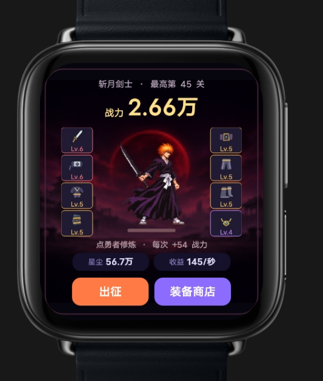
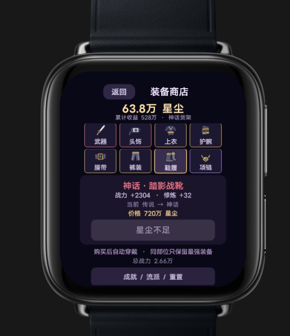

# 弑界·斩月

一款面向 BlueOS 手表的修炼养成与回合对决游戏。点击修炼积累战力，购置装备强化实力，再出征挑战更强的对手，逐关突破试炼。

## 玩法介绍

- **点击修炼**：在主页点击剑士修炼，提升战力与收益。
- **购置装备**：进入装备商店，使用星尘购买装备，提升战力，为后续挑战做准备。
- **出征挑战**：查看对手战力和挑战信息，选择挑战后进入试炼。
- **轮流出招**：双方按回合交替攻击，画面会展示招式效果与伤害变化。
- **逐关突破**：击败当前对手后继续挑战；遇到强敌时，可以返回修炼、积攒星尘并更新装备，再回来迎战。

**核心循环：修炼积累 → 购买装备 → 出征对决 → 逐关成长。**

## 游戏截图

### 修炼主页

### 挑战预览

### 回合对战

### 装备商店

## 安装包

- [下载《弑界·斩月》RPK 1.0.0](release/shijie-zhanyue-1.0.0.rpk)
- 包名：`com.hxz.startycoon`
- 版本：`1.0.0`（调试构建）
- 支持表型：圆表、方表（`watch-round` / `watch-square`）
- 最低平台版本：`1070`

本仓库包含安装包、清单和展示截图；未包含完整工程源码。当前未附开源许可证。